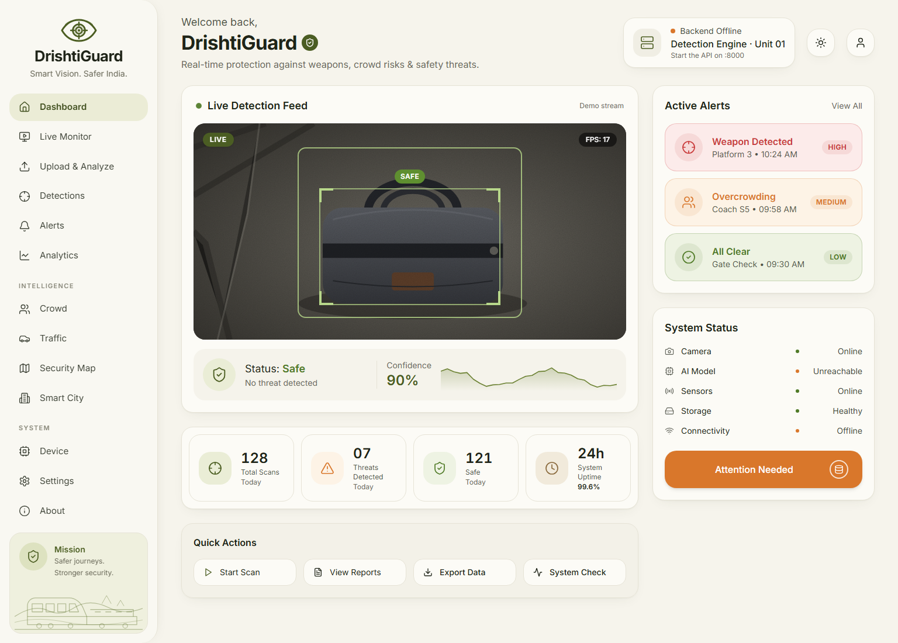
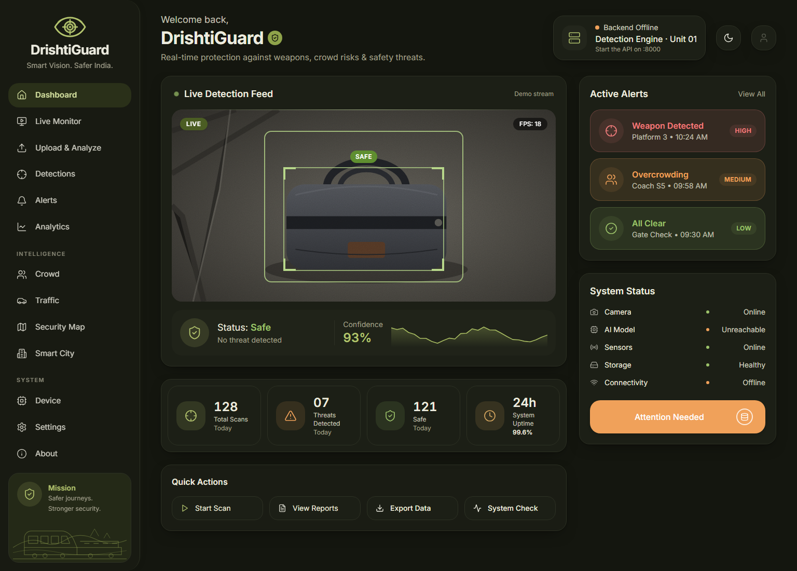

<div align="center">


# DrishtiGuard

**Smart Vision. Safer India.**

AI-powered surveillance that spots weapons, crowd risks and safety hazards in CCTV footage, and presents them in a calm, readable command dashboard.




</div>

---

## Contents

- [What it does](#what-it-does)
- [Architecture](#architecture)
- [Repository layout](#repository-layout)
- [Getting started](#getting-started)
- [Configuration](#configuration)
- [API reference](#api-reference)
- [AI models](#ai-models)
- [Training pipeline (ML)](#training-pipeline-ml)
- [UI and theme](#ui-and-theme)
- [Troubleshooting](#troubleshooting)

---

## What it does

| Capability | Details |
|---|---|
| **Weapon detection** | Handgun, rifle and knife detection using a Phase 1 YOLO11m model plus a YOLO-World open-vocabulary weapon scan |
| **Crowd intelligence** | Person counting, density estimation, *Crowd / Dense Crowd / Overcrowding* levels |
| **Traffic monitoring** | Car, bus, truck and motorcycle tracking with ByteTrack, plus rash-driving heuristics |
| **Safety monitoring** | Fire, smoke and face-mask (mask / no-mask) detection |
| **Threat scoring** | Merged detections scored as **Safe → Moderate → High → Critical** risk |
| **Reports** | Timeline of events, screenshots of key frames, summary and risk score per video |
| **Dashboard** | Live feed view, active alerts, system status, analytics, crowd/traffic/map pages, and light and dark themes |

Typical flow: **upload a CCTV clip → the backend analyses it → you review events, screenshots and risk in the UI.**

---

## Architecture

```
┌──────────────────────────┐        /api (Vite proxy)        ┌───────────────────────────────┐
│  front end/  (React 19)  │ ──────────────────────────────▶ │  backend/  (FastAPI :8000)     │
│  Dashboard · Upload ·    │ ◀────────────────────────────── │  upload · analyze · files      │
│  Alerts · Analytics …    │        JSON + media URLs        │  pipeline · risk scoring       │
└──────────────────────────┘                                 └──────────────┬────────────────┘
                                                                            │ USE_MASTER_ENGINE=true
                                                                            ▼
                                                          ┌──────────────────────────────────┐
                                                          │ ai_models/MasterDetectionEngine  │
                                                          │  Model A  Security (frozen)      │
                                                          │  Model B  Crowd                  │
                                                          │  Model C  Traffic                │
                                                          │  Model D  Safety                 │
                                                          └──────────────┬───────────────────┘
                                                                         │ weights
                                                                         ▼
                                                          ┌──────────────────────────────────┐
                                                          │ ml/  Phase 1 training pipeline   │
                                                          │ download → prepare → train →     │
                                                          │ validate → export                │
                                                          └──────────────────────────────────┘
```

Analysis pipeline inside the backend:

```
Upload → Master Engine → Model A (+ YOLO-World weapons) → Model D filter
       → Model B crowd heuristics → Model C traffic → Merge → Threat score → Report
```

For the full design, see [docs/MULTI_MODEL_ARCHITECTURE.md](docs/MULTI_MODEL_ARCHITECTURE.md).

---

## Repository layout

```
Drishti gaurd/
├── front end/                 # React 19 + Vite 6 + Tailwind v4 web app
│   ├── public/favicon.svg
│   └── src/
│       ├── app/
│       │   ├── layouts/RootLayout.tsx     # sidebar + top bar shell
│       │   ├── pages/                     # Dashboard, LiveDetection, UploadAnalyze, …
│       │   ├── components/                # BrandMark, ThemeToggle, module wheel
│       │   └── hooks/useBackendHealth.ts  # polls /api/health
│       ├── services/api.ts                # typed client for the FastAPI backend
│       └── styles/theme.css               # design tokens (olive theme)
├── backend/                   # FastAPI analysis API
│   ├── app/api/routes/        # upload.py · analyze.py · files.py
│   ├── app/services/          # pipeline, yolo_detector, weapon_detector, crowd, traffic, risk
│   └── run.py
├── ai_models/                 # Multi-model layer + MasterDetectionEngine
│   ├── Model_A_SecurityThreats/   (frozen Phase 1 weights)
│   ├── Model_B_CrowdBehavior/
│   ├── Model_C_TrafficMonitoring/
│   ├── Model_D_SafetyMonitoring/
│   └── MasterDetectionEngine/
├── ml/                        # Phase 1 dataset + training pipeline (see ml/README.md)
└── docs/                      # architecture notes, screenshots
```

---

## Getting started

**Prerequisites:** Python 3.10+, Node.js 18+ (with `pnpm` or `npm`), and optionally an NVIDIA GPU with CUDA.

Run the backend and the frontend in two terminals, then open the app:

| URL | What |
|---|---|
| http://localhost:5173 | Landing page |
| http://localhost:5173/app | Dashboard |
| http://localhost:5173/app/upload | Upload & Analyze |
| http://127.0.0.1:8000/docs | Interactive API docs (Swagger) |

### 1. Backend

```bash
cd backend
python -m venv .venv
.venv\Scripts\activate          # macOS/Linux: source .venv/bin/activate
pip install -r requirements.txt
copy .env.example .env          # macOS/Linux: cp .env.example .env
python run.py
```

### 2. AI models (once)

Copy the trained Phase 1 weights into Model A. This never overwrites existing weights.

```bash
python -m ai_models.setup_models
```

### 3. Frontend

```bash
cd "front end"
pnpm install      # or: npm install
pnpm dev          # or: npm run dev
```

In development, Vite proxies `/api/*` to `http://127.0.0.1:8000` (see `front end/vite.config.ts`).

| Script | Purpose |
|---|---|
| `pnpm dev` | Dev server with hot reload |
| `pnpm build` | Production build to `dist/` |
| `pnpm preview` | Serve the production build locally |
| `pnpm typecheck` | TypeScript check |

---

## Configuration

### `backend/.env`

| Variable | Default | Description |
|---|---|---|
| `HOST` / `PORT` | `0.0.0.0` / `8000` | API bind address |
| `CORS_ORIGINS` | `http://localhost:5173,…` | Allowed frontend origins |
| `DATA_DIR` | `./data` | Uploads, screenshots, JSON store |
| `MAX_UPLOAD_MB` | `10240` | Upload size limit |
| `MONGODB_URL` | *(empty)* | Leave empty to use `data/db_store.json` |
| `YOLO_MODEL` | `yolo11n.pt` | Base detector |
| `CUSTOM_MODEL_PATH` | `../ml/models/phase1/best.pt` | Trained Phase 1 weights |
| `WEAPON_WORLD_MODEL` | `yolov8s-worldv2.pt` | YOLO-World weapon scanner |
| `ENABLE_WEAPON_SCAN` | `true` | Keep on for handgun/rifle accuracy |
| `WEAPON_CONFIDENCE_THRESHOLD` | `0.22` | Weapon scan threshold |
| `CONFIDENCE_THRESHOLD` | `0.45` | General detection threshold |
| `DEVICE` / `USE_GPU` | `cuda` / `true` | Set `cpu` / `false` without a GPU |
| `USE_MASTER_ENGINE` | `true` | Route analysis through `ai_models/` |
| `FRAME_SAMPLE_RATE` | `5` | Analyse every N-th frame |
| `BATCH_SIZE` | `16` | Inference batch size |
| `SIMULATION_MODE` | `false` | Skip loading YOLO weights (for testing the API/UI without models) |

### `front end/.env`

| Variable | Default | Description |
|---|---|---|
| `VITE_API_BASE_URL` | *(empty)* | Leave empty with the Vite proxy; set to the API origin for a separate deployment |

---

## API reference

Base URL: `http://127.0.0.1:8000`

| Method | Path | Description |
|---|---|---|
| `GET` | `/api/health` | Service health (used by the dashboard's connection indicator) |
| `POST` | `/api/upload` | Upload a video (`multipart/form-data`, field `file`) and get `upload_id` back |
| `POST` | `/api/analyze/{upload_id}` | Start background analysis |
| `GET` | `/api/analyze/{upload_id}/progress` | Poll progress (`status`, `progress`, `current_step`, `message`) |
| `GET` | `/api/analyze/{upload_id}/results` | Full analysis result JSON |
| `GET` | `/api/analytics/{upload_id}` | Alias of results |
| `GET` | `/api/files/videos/{upload_id}` | Stream the uploaded video |
| `GET` | `/api/files/screenshots/{upload_id}/{filename}` | Event screenshot |

```bash
# Example
curl -F "file=@cctv.mp4" http://127.0.0.1:8000/api/upload
curl -X POST http://127.0.0.1:8000/api/analyze/<upload_id>
curl http://127.0.0.1:8000/api/analyze/<upload_id>/progress
```

---

## AI models

| Model | Purpose | Status | Classes / output |
|---|---|---|---|
| **A: Security Threats** | Weapons, people, vehicles | ✅ Trained (Phase 1, **frozen**) | Person, Handgun, Knife, Vehicle, Bus, Truck, Motorcycle |
| **B: Crowd Behaviour** | Density and crowd levels | ⏳ Heuristic fallback | Crowd, Dense_Crowd, Overcrowding |
| **C: Traffic Monitoring** | Vehicle flow and rash driving | ⏳ Uses Model A vehicles + tracker | Vehicle tracks, speed events |
| **D: Safety Monitoring** | Fire, smoke, masks | ⏳ Phase 1 class filter | Fire, Smoke, Mask, No_Mask |

- Model A weights live at `ai_models/Model_A_SecurityThreats/weights/best.pt`. **Do not retrain or overwrite them.**
- To train Models B, C and D once their datasets are ready, run `python ai_models/scripts/audit_datasets.py` and then `python ai_models/scripts/run_bcd_pipeline.py --model all` from the `ml/` virtual environment.
- Threat priority: Handgun, Rifle, Fire, Accident and Violence are **critical**. Knife, Fighting and Overcrowding are **high**. Smoke and mask violations are **medium**.

See [ai_models/README.md](ai_models/README.md) for more detail.

---

## Training pipeline (ML)

The Phase 1 pipeline is sized for an **RTX 3050 6 GB, 32 GB RAM, and a 10 GB dataset cap**.

```powershell
cd ml
python -m venv .venv; .venv\Scripts\activate
pip install -r requirements.txt

python scripts/download_all.py   # SOHAS, Open Images weapons, COCO, RMFD, D-Fire, CrowdHuman, BDD100K, RWF-2000
python scripts/prepare_all.py    # unify to YOLO format → prepared/drishti_phase1
python scripts/train.py          # YOLO11m, 100 epochs, imgsz 640, AMP
python scripts/validate.py       # mAP50 / mAP50-95 / P / R → reports/phase1/metrics.json
python scripts/export.py         # ONNX + TorchScript
```

Full details are in [ml/README.md](ml/README.md).

---

## UI and theme

The interface uses an **"Olive Field"** theme: warm cream surfaces, deep olive accents and soft sage highlights. It aims to feel calm and trustworthy rather than alarming. Red, orange and green are reserved for threat severity, so an alert stands out.

<table>
  <tr>
    <td></td>
    <td></td>
  </tr>
  <tr>
    <td align="center"><sub>Light</sub></td>
    <td align="center"><sub>Dark</sub></td>
  </tr>
</table>

### Palette

| Token | Light | Dark | Used for |
|---|---|---|---|
| `--background` | `#f6f4ec` | `#14160f` | Page |
| `--card` | `#fcfbf6` | `#1c1f16` | Cards, sidebar |
| `--primary` | `#4b5d23` | `#8fa34a` | Primary buttons, badges |
| `--accent` | `#6b8132` | `#a9bd62` | Charts, highlights |
| `--secondary` | `#ebecd6` | `#2a3019` | Active nav, soft fills |
| `--safe` | `#4f7a26` | `#9cc26a` | Safe / low |
| `--warn` | `#d9772b` | `#f0a15a` | Medium / attention |
| `--danger` | `#c93a3a` | `#f07c7c` | High / critical |

All tokens are defined in [`front end/src/styles/theme.css`](front%20end/src/styles/theme.css). The Tailwind `cyan`, `blue`, `sky` and `indigo` palettes are **remapped to an olive scale**, and `slate` and `gray` are remapped to warm neutrals, so every page shares the theme. You can also use `bg-olive-500`, `text-safe`, `bg-danger-bg` and similar classes directly.

### Dashboard layout

- **Sidebar**: brand mark, grouped navigation (Monitor / Intelligence / System) and a mission card. On mobile it becomes a slide-in drawer.
- **Top bar**: greeting, a **live backend connection card** that polls `/api/health` every 15 s, a theme toggle and a profile button.
- **Live Detection Feed**: camera frame with detection boxes, FPS and a rolling confidence sparkline.
- **Stats row**: total scans, threats detected, safe count and uptime.
- **Quick Actions**: start a scan, view reports, **export a JSON snapshot** and run a **system check**.
- **Active Alerts / System Status**: severity-coloured alerts and component health. The status button turns amber when the backend is unreachable.

> The dashboard feed, alerts and counters are **sample data** until live camera streams are connected. Backend connectivity and the system check are real.

### Keyboard shortcuts

| Key | Action |
|---|---|
| `Tab` | Open the radial module wheel (quick page switcher) |
| `S` | Toggle the module deck at the bottom |
| Theme button | Switch between light and dark (saved in `localStorage`) |

---

## Troubleshooting

| Symptom | Fix |
|---|---|
| Top bar shows **Backend Offline** | Start the API (`python backend/run.py`) and check that http://127.0.0.1:8000/api/health returns `{"status":"ok"}` |
| CORS errors in the browser | Add your frontend origin to `CORS_ORIGINS` in `backend/.env` |
| `CUDA out of memory` | Lower `BATCH_SIZE`, or set `DEVICE=cpu` / `USE_GPU=false` |
| No weapons detected | Keep `ENABLE_WEAPON_SCAN=true` and check that `WEAPON_WORLD_MODEL` downloaded |
| Model A weights missing | Run `python -m ai_models.setup_models` after Phase 1 training |
| Testing the API/UI without model weights | Set `SIMULATION_MODE=true` in `backend/.env` |

---

<div align="center">
<sub>DrishtiGuard · Safer journeys. Stronger security.</sub>
</div>
